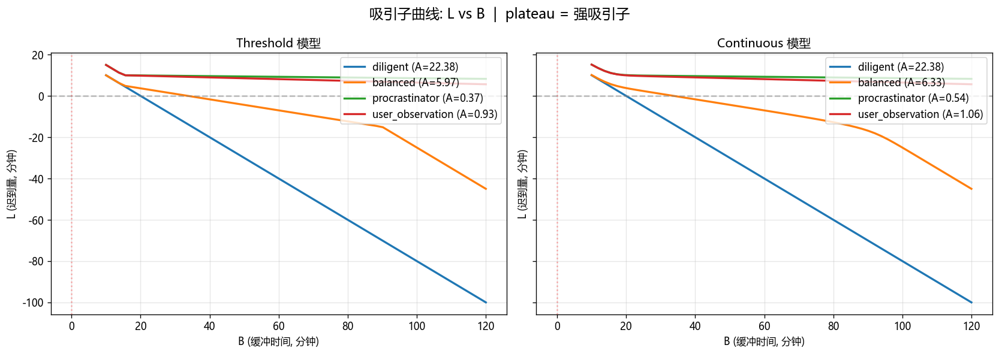

# Numerical Psychology：拖延的数值玩具模型

**为什么闹钟提前，迟到却未必减少？** 五种数值玩具模型探索紧迫感、工作速度和截止压力如何产生近似恒定的迟到平台。

[English](README.md) · [模型源码](procrastination/) · [历史](docs/README-history.md)



*公开仓库原有的模型生成图。预设名称用于说明，不是被试测量或临床证据。*

## 探索的问题

| 模型 | 探索的机制 |
|---|---|
| Threshold | 截止前切换工作速度 |
| Continuous | 用平滑紧迫感代替阶跃 |
| TMT-inspired | 简化动机公式改变紧迫感 |
| Yerkes–Dodson-inspired | 假设压力过大使工作速度下降 |
| Planning Fallacy | 在其他模型外加入工作量估计噪声 |

阈值模型中，`B` 为缓冲时间，`W` 为工作量，`vs` 为慢速，`vf` 为应急速度，`T*` 为紧迫感阈值。在适用分支中：

```text
L = (W - vs (B - T*)) / vf - T*
```

当 `vs` 接近零且 `B > T*`，迟到量 `L` 接近 `W/vf - T*`，几乎不随缓冲时间变化。这里的“吸引子”用于描述参数响应的平台，不代表已证明普适心理规律，也不是对五种模型都成立的严格动力系统吸引子结论。

## 运行与探索

```bash
python -m pip install -r requirements.txt
streamlit run app/streamlit_app.py
```

选择预设，对比迟到曲线、轨迹和相图。重新生成已有数值图：

```bash
python experiments/01_attractor_curve.py
python experiments/02_phase_diagram.py
python experiments/03_trajectory.py
```

| 位置 | 内容 |
|---|---|
| [procrastination/](procrastination/) | 模型与数值工具 |
| [app/streamlit_app.py](app/streamlit_app.py) | 交互比较 |
| [experiments/](experiments/) | 作图脚本 |
| [figures/](figures/) | 已有示例图 |

## 状态、参考与许可

项目是探索性建模笔记／应用，没有实证数据集、拟合人群模型或经过验证的干预方案。[原说明](docs/README-history.md) 中的理论启发包括 Steel（2007）、Yerkes 与 Dodson（1908）、Kahneman 与 Tversky（1979）；这里采用简化示例，不是这些理论的完整复现。本次文档整理未重跑模型。

本快照未声明仓库整体的开源许可证。源码公开不等于无限制使用授权；第三方内容仍适用各自条款。
